<div align="center">
  <h1>🎙️ Voice2Voice-v2</h1>
  <p><b>Modular Offline Multilingual Speech-to-Speech Translation with Confidence-Aware ASR Routing and Language-Aware TTS</b></p>

  <p>
    🔐 Licensed under <b>MIT License</b> (Upstream model weights governed by respective provider licenses)<br/>
    📌 By <b>D. Sri Vighna Teja (Teja DVST)</b> | 2026<br/>
    📄 Companion Implementation of <i>Nature Scientific Reports</i> (2026) 16:36511
  </p>

  <div>
    <a href="https://doi.org/10.1038/s41598-026-67788-0"></a>
    <a href="https://www.python.org/"></a>
    <a href="LICENSE"></a>
    
    
  </div>

  <p>
    <a href="#-executive-overview"><b>Overview</b></a> &nbsp;•&nbsp;
    <a href="#system-architecture"><b>Architecture</b></a> &nbsp;•&nbsp;
    <a href="#-systems-design--engineering-rationale"><b>Design Rationale</b></a> &nbsp;•&nbsp;
    <a href="#-empirical-benchmarks-nature-scientific-reports-2026"><b>Benchmarks</b></a> &nbsp;•&nbsp;
    <a href="#-forensic-engineering--edge-case-resolutions"><b>Forensic RCA</b></a> &nbsp;•&nbsp;
    <a href="#-cli-usage--routing-matrix"><b>CLI Usage</b></a>
  </p>
</div>

---

<div align="center">

| 🧭 Routing Accuracy ($\tau=0.70$) | 🎯 Telugu ASR Accuracy | 🌐 CVSS S2ST Quality | 💾 Local CPU Memory | 🧪 Verification Suite |
| :---: | :---: | :---: | :---: | :---: |
| **97.65%**<br/>*(3.7% Mean Fallback)* | **19.79% WER**<br/>*(vs. 107.42% Whisper-Only)* | **31.4 – 39.2**<br/>*(ASR-BLEU across 5 X➔EN)* | **2.0 – 3.5 GB**<br/>*(Local CPU Unified RAM)* | **23 / 23 Passing**<br/>*(Standalone Offline)* |

</div>

---

> **The Challenge:** Offline speech-to-speech translation (S2ST) is essential for privacy-sensitive and connectivity-constrained environments—such as regional healthcare communication, field assistance, and air-gapped workflows—where cloud APIs introduce network dependency, recurring cost, and voice data exposure. However, deploying multilingual S2ST locally on standard 8 GB CPU hardware presents a core trade-off: general-purpose ASR models (`Whisper`) suffer severe recognition collapse on Indic languages, while holding multiple specialized neural models concurrently strains local RAM.
>
> **The Solution:** **Voice2Voice-v2** is the consolidated, modular open-source software implementation of the offline S2ST framework published in *Nature Scientific Reports* (2026, Vol. 16, Article 36511). Combining **confidence-aware ASR routing ($\tau = 0.70$)**, **dynamic INT8 translation**, **language-aware speech synthesis**, and **sequential model unloading**, the system executes turn-based multilingual speech translation across **28 directional language pairs** entirely offline on local CPU hardware.

---

## 📋 Executive Overview

Built to operationalize the peer-reviewed modular routing architecture on local CPU hardware (Apple Silicon M3, 8-core CPU, 8 GB unified memory):

| 🔒 **100% Air-Gapped Offline Execution** | 🎯 **Language-Specialized ASR Routing** |
| :--- | :--- |
| Enforces <kbd>HF_HUB_OFFLINE=1</kbd>, <kbd>TRANSFORMERS_OFFLINE=1</kbd>, and <kbd>HF_DATASETS_OFFLINE=1</kbd> at launcher startup—zero audio frames, intermediate transcripts, or telemetry logs leave the host workstation. | Pairs <kbd>Whisper-Small</kbd> (LID + global ASR) with <kbd>IndicConformer-600M</kbd> for high-confidence Indic speech ($c(x) \ge 0.70$), cutting Telugu WER from **107.42% to 19.79%** and Hindi from **48.37% to 7.80%**. |
| 🧠 **Modular Cascade & Memory Discipline** | 🛠️ **Interactive CLI & Verification Suite** |
| Decouples LID, ASR, NMT (<kbd>NLLB-200 distilled-600M</kbd> INT8), and TTS (<kbd>IndicParler-TTS</kbd> / <kbd>pyttsx3</kbd>) with sequential model unloading, operating within a **2.0–3.5 GB** local RAM envelope. | Extends the core research pipeline with bidirectional auto-dialogue pairs (<kbd>-p</kbd>), source-locked bypass (<kbd>-S</kbd>), pre-ASR silence gating, decimal-safe clause splitting, 8-point WAV checks, and **23 standalone tests**. |

---

<a id="system-architecture"></a>
## 🏛️ System Architecture

Voice2Voice-v2 implements a decoupled, 4-stage pipeline that separates acoustic signal gating, constrained softmax ASR routing, quantized neural translation, and structurally validated speech synthesis.

```mermaid
flowchart TD
    classDef io fill:#F8FAFC,stroke:#64748B,stroke-width:1.5px,color:#0F172A;
    classDef asr fill:#EFF6FF,stroke:#2563EB,stroke-width:2px,color:#1E3A8A,font-weight:bold;
    classDef nmt fill:#F0FDFA,stroke:#0D9488,stroke-width:2px,color:#115E59,font-weight:bold;
    classDef tts fill:#FAF5FF,stroke:#9333EA,stroke-width:2px,color:#581C87,font-weight:bold;
    classDef flush fill:#FFFBEB,stroke:#D97706,stroke-width:1.5px,color:#92400E;

    subgraph Stage0 ["Stage 0: Acoustic Capture & Signal Gating (utils/audio.py)"]
        MIC["<b>16 kHz 16-Bit Mono Audio</b><br/>Live Mic (sounddevice) or WAV Input<br/>100ms DAC Cue Settling Guard"]:::io
        GATE["<b>RMS Energy Gate & Trimming</b><br/>• Rejects Silence (< -48.0 dBFS)<br/>• Trims Dead Air (< -35.0 dBFS) + 80ms Pad"]:::io
        MIC --> GATE
    end

    subgraph Stage1 ["Stage 1: Confidence-Aware Dual-ASR Router (models/asr.py · Paper Eq. 1–3)"]
        LID{"<b>Constrained Softmax LID</b><br/>Whisper-Small Encoder<br/>Candidate Set L (tau = 0.70)"}:::asr
        INDIC["<b>ai4bharat/indic-conformer-600m</b><br/>ONNX Runtime (4 Threads Pinned)<br/>Telugu, Hindi, Tamil, Bengali"]:::asr
        INTL["<b>openai/whisper-small</b><br/>Mel-Spectrogram Reuse (FP32)<br/>English & Global Languages"]:::asr
        NORM["<b>Indic Unicode & CTC Sanitizer</b><br/>NFC + Duplicate Matra & Loop Collapse"]:::asr

        GATE --> LID
        LID -- "Indic & c(x) >= 0.70 (or Pair Lock)" --> INDIC
        LID -- "Non-Indic or c(x) < 0.70" --> INTL
        INDIC --> NORM
        INTL --> NORM
    end

    FLUSH1(["<b>Stage-and-Flush 1:</b> unload_asr() + gc.collect() ➔ Reclaims ASR Memory"]):::flush

    subgraph Stage2 ["Stage 2: Quantized Neural Machine Translation (models/translation.py)"]
        SPLIT["<b>Decimal-Safe Clause Splitter</b><br/>Splits Sentences & Dandas (।, ॥)<br/>Protects Decimals (e.g., 3.5)"]:::nmt
        NLLB["<b>facebook/nllb-200-distilled-600M</b><br/>Dynamic INT8 (QNNPACK ARM / FBGEMM x86)<br/>Beam Search (num_beams=5)"]:::nmt
        SPLIT --> NLLB
    end

    FLUSH2(["<b>Stage-and-Flush 2:</b> unload_nllb() + gc.collect() ➔ Reclaims NMT Memory"]):::flush

    subgraph Stage3 ["Stage 3: Dual-Route Synthesis & 8-Point WAV Guard (models/tts.py)"]
        ROUTE{"<b>Target Language Router</b>"}:::tts
        PARLER["<b>ai4bharat/indic-parler-tts</b><br/>Cached Prompt Embedding<br/>Dynamic DAC Bounds [170, 420] @ 86.13 Hz"]:::tts
        OSVOICE["<b>Host OS Speech (pyttsx3)</b><br/>NSSpeechSynthesizer / eSpeak / SAPI5"]:::tts
        GUARD["<b>8-Point Structural WAV Gate</b><br/>44.1 kHz Mono, Finite, > -60 dBFS"]:::tts

        ROUTE -- "Indian Targets (22 Scheduled)" --> PARLER
        ROUTE -- "Western / Intl Targets" --> OSVOICE
        PARLER --> GUARD
    end

    NORM --> FLUSH1 --> SPLIT
    NLLB --> FLUSH2 --> ROUTE
```



---

## 💡 Systems Design & Engineering Rationale

Every design choice in Voice2Voice-v2 balances linguistic quality against local CPU and unified memory constraints:

| Requirement / Challenge | Technical Implementation | Engineering & Systems Rationale |
| :--- | :--- | :--- |
| **Low-Resource Indic ASR Accuracy** | **Confidence-Aware Dual-ASR ($\tau = 0.70$)** (`IndicConformer-600M` + `Whisper-Small`) | Monolithic `Whisper-Small` yields `107.42%` WER on Telugu due to token insertion loops. Constraining Whisper LID logits to the candidate set $\mathcal{L}$ and routing Indic speech at $c(x) \ge 0.70$ to `IndicConformer-600M` cuts Telugu WER to `19.79%`. |
| **8 GB Unified RAM Constraint** | **Sequential Stage-and-Flush Lifecycle** (`unload_asr` $\to$ `unload_nllb` $\to$ `unload_tts`) | Explicitly dereferencing each model and invoking `gc.collect()` between stages keeps peak resident memory within **`2.0–3.5 GB`** (`~2.4–3.2 GB` observed during neural Indic synthesis) on 8 GB laptops. |
| **NMT Footprint & Load Speed** | **Dynamic INT8 Quantization** (`qnnpack` on ARM64 / `fbgemm` on x86_64) | Quantizing linear layers to `torch.qint8` halves NMT memory footprint and accelerates CPU matrix operations while preserving translation quality across 200 FLORES languages. |
| **TTS Prompt & Frame Control** | **In-Memory Prompt Conditioning Cache** + **Dynamic DAC Frame Bounds `[170, 420]`** | Caching the speaker conditioning embedding avoids redundant text-encoder passes across turns, while bounding DAC vocoder frames (`1.97s–4.88s` at `86.13 Hz`) prevents runaway trailing static on short utterances. |
| **CPU Thread Contention** | **Explicit 4-Thread Compute Pool** (`torch.set_num_threads(4)` + ONNX `intra_op=4`) | Prevents thread oversubscription on 8-core laptop CPUs and reserves OS scheduling headroom for CoreAudio microphone capture and speaker playback. |
| **Turn-Based Dialogue Friction** | **Bi-Directional Pair Mode (`-p en:te`)** + **Out-of-Pair Acoustic Guard** | Evaluates pairwise softmax strictly over $\{\ell_1, \ell_2\}$ for known speakers while monitoring all 9 runtime languages in the background to flag unconfigured third-language speech (`p > 0.60`). |
| **Western Language Latency** | **Language-Aware Hybrid TTS** (`IndicParler-TTS` vs. `pyttsx3`) | Routes Indic targets to neural `IndicParler-TTS` (`MOS 3.95–4.12`) while delegating English and European languages to lightweight host OS speech synthesis (`pyttsx3`). |

---

## 📊 Empirical Benchmarks (*Nature Scientific Reports*, 2026)

All corpus-level benchmarks below are reported from the peer-reviewed *Nature Scientific Reports* evaluation (**Apple Silicon M3, 8-core CPU, 8 GB unified memory, CPU-only execution**, deterministic 5-fold protocol with Seed 42).

### 1. Eight-Language ASR & Routing Evaluation (FLEURS Official Test Splits, $n = 5,017$)

- **Group-Level LID Accuracy:** **97.65%** balanced accuracy (`97.10%` Indic recall; `98.20%` non-Indic recall) with a **3.7%** mean confidence fallback rate at $\tau = 0.70$.

| Language | Family | FLEURS Split ($n$) | Primary Routed Backend | Whisper-Only WER (%) | Routed System WER (%) | Oracle Upper Bound (%) |
| :--- | :--- | :---: | :--- | :---: | :---: | :---: |
| **Hindi (`hi`)** | Indo-Aryan | 418 | `IndicConformer-600M` | 48.37% | **7.80%** (±0.42) | 7.55% |
| **Telugu (`te`)** | Dravidian | 472 | `IndicConformer-600M` | 107.42% *(Insertion loops)* | **19.79%** (±0.91) | 19.25% |
| **Tamil (`ta`)** | Dravidian | 591 | `IndicConformer-600M` | 58.60% | **17.40%** (±0.74) | 16.85% |
| **Bengali (`bn`)** | Indo-Aryan | 920 | `IndicConformer-600M` | 38.90% | **12.90%** (±0.58) | 12.45% |
| **French (`fr`)** | Romance | 676 | `Whisper-Small` | 15.91% | **15.91%** (±0.51) | 15.70% |
| **German (`de`)** | Germanic | 862 | `Whisper-Small` | 10.16% | **10.16%** (±0.39) | 9.95% |
| **Arabic (`ar`)** | Semitic | 428 | `Whisper-Small` | 22.10% | **21.80%** (±0.66) | 21.35% |
| **Japanese (`ja`)** | Japonic | 650 | `Whisper-Small` | 18.70% | **18.50%** (±0.62) | 18.10% |

### 2. Translation, End-to-End S2ST, TTS & Resource Profile

| Evaluation Dimension | Benchmark Scope | Measured Results |
| :--- | :--- | :--- |
| **Clean vs. Cascaded NMT** | FLORES-200 `devtest` ($n = 1,012$, 16 directions) | `HI→EN`: `41.55` clean vs. `39.02` cascaded BLEU; `TE→EN`: `37.41` clean vs. `32.86` cascaded BLEU. Without ASR routing (`Whisper-only`), `TE` drops by **$-8.26$ BLEU** (to `10.86`). |
| **End-to-End S2ST** | CVSS Official Test Split (5 supported `X → EN` directions) | **31.4 to 39.2 ASR-BLEU** (`39.2` `FR→EN`, `38.6` `DE→EN`, `36.4` `AR→EN`, `33.8` `JA→EN`, `31.4` `TA→EN`) with back-ASR WER of `8.9%–13.6%`. |
| **TTS Naturalness & Intelligibility** | 8 Target Languages (`IndicParler-TTS` & `pyttsx3`) | Subjective 5-point MOS of **3.55 – 4.12** (`4.12` Hindi, `4.03` Tamil, `3.98` Bengali, `3.95` Telugu) and back-ASR WER of **6.8% – 10.8%**. |
| **Corpus Latency & Resource Envelope** | Stipulated 8-Language CPU Evaluation (Full corpus utterances) | Mean model-only latency of **25.41s** (`ASR 1.79s`, `NMT 14.00s`, `TTS 9.62s`), ranging from `18.60s` (`AR`) to `28.18s` (`TE`); **30–50%** CPU utilization; **2.0–3.5 GB** RAM. |

> **Note on Interactive Runtime Turns:** Latency scales directly with utterance duration and target TTS backend (`IndicParler-TTS` neural synthesis vs. `pyttsx3` system speech). On shorter conversational inputs (`~2.5–3s` speech) and `Indic → English` turns, local model compute typically completes in **`~5.5s–14s`** while remaining within the **`~2.4–3.2 GB`** peak unified memory footprint.

---

## 🔍 Forensic Engineering & Edge-Case Resolutions

Operationalizing the modular pipeline for interactive local execution required diagnosing and resolving four concrete systems edge cases:

### 1. Multi-Clause `<eos>` Truncation vs. Decimal Erasure &nbsp;<kbd>models/translation.py</kbd>

| Stage | Technical Analysis |
| :--- | :--- |
| **Symptom** | Feeding multi-sentence speech (e.g., *"The fare is 3.5 rupees. Please pay at the counter."*) into `NLLB-200` caused premature `</s>` termination after the first clause, while naive period-splitting fractured `3.5` into `"3"` and `"5"`. |
| **Root Cause** | Distilled sequence-to-sequence models exhibit premature end-of-sequence bias on run-on spoken transcripts, whereas naive delimiter regexes cannot distinguish sentence boundaries from floating-point decimals. |
| **Remediation** | Implemented `CLAUSE_SPLIT_REGEX` (`r'(?<=[.?!।॥])\s+\|(?<=[?!।॥])(?=\S)\|(?<=\.)(?=[A-Z\u0900-\u0D7F])'`) to split Latin punctuation and Brahmic dandas (`।`, `॥`) cleanly while preserving decimal numbers intact. |

### 2. Parler-TTS Trailing Vocoder Static & Frame-0 Clicks &nbsp;<kbd>models/tts.py</kbd>

| Stage | Technical Analysis |
| :--- | :--- |
| **Symptom** | Fixed-length vocoder generation emitted trailing static noise on short single-word Indic responses or collapsed into zero-frame clicks. |
| **Root Cause** | Unbounded autoregressive DAC token generation at `86.13 Hz` lacked lower and upper duration guards, and raw file writes were dispatched without post-synthesis audio checks. |
| **Remediation** | Added `calculate_dynamic_dac_frames()` (`min(420, max(170, int((words * 0.45 + 1.2) * 86.13)))`, bounding synthesis to `1.97s–4.88s`) paired with an **8-point structural WAV integrity check** (`44.1 kHz` 1D mono, `np.isfinite`, energy `> -60 dBFS`). |

### 3. Indic CTC Vowel-Sign Repetition &nbsp;<kbd>models/asr.py</kbd>

| Stage | Technical Analysis |
| :--- | :--- |
| **Symptom** | Fast Indic speech occasionally caused CTC greedy decoding to emit consecutive duplicate combining vowel marks (e.g., `U+0C4B U+0C4B`), fragmenting subwords in SentencePiece tokenization. |
| **Root Cause** | Uncollapsed consecutive combining diacritics emitted across adjacent CTC frames on rapid Dravidian and Indo-Aryan utterances. |
| **Remediation** | Added canonical Unicode NFC normalization with targeted combining-mark deduplication (`[\u0c3e-\u0c4d]` for Telugu, `[\u093e-\u094d]` for Devanagari) while preserving valid consonant gemination and numerals. |

### 4. macOS OpenMP Subprocess Fork Abort &nbsp;<kbd>utils/system.py</kbd> &nbsp;<kbd>run_pipeline.py</kbd> &nbsp;<kbd>test_sprints.py</kbd>

| Stage | Technical Analysis |
| :--- | :--- |
| **Symptom** | Spawning child CLI processes after PyTorch/ONNX initialization on macOS triggered `SIGABRT (-6)` (`OMP: Error #179: Can't open SHM`). |
| **Root Cause** | Intel OpenMP (`libomp`) POSIX shared-memory collision across forked processes on Darwin. |
| **Remediation** | Enforced `KMP_INIT_AT_FORK=FALSE` and `KMP_DUPLICATE_LIB_OK=TRUE` prior to runtime initialization across entry points and test harnesses. |

---

## 💻 CLI Usage & Routing Matrix

Voice2Voice-v2 supports **28 directional translation pairs** (14 reciprocal pairs across English, Hindi, Telugu, Tamil, Bengali, French, German, Arabic, and Japanese) via a single-line synchronized progress terminal (`StudioCanvas`):

| Dialogue Quadrant | Example Command | ASR Engine | NMT Engine | TTS Engine |
| :--- | :--- | :--- | :--- | :--- |
| **Intl ➔ Indic** | `./start.sh -p en:te` | `Whisper-Small` | `NLLB-200 (INT8)` | `IndicParler-TTS` |
| **Indic ➔ Intl** | `./start.sh -p te:en` | `IndicConformer-600M` | `NLLB-200 (INT8)` | `Host OS Voice (pyttsx3)` |
| **Indic ➔ Indic** | `./start.sh -p hi:te` | `IndicConformer-600M` | `NLLB-200 (INT8)` | `IndicParler-TTS` |
| **Intl ➔ Intl** | `./start.sh -p fr:en` | `Whisper-Small` | `NLLB-200 (INT8)` | `Host OS Voice (pyttsx3)` |

### Quick Start Commands

```bash
# 1. Bi-Directional Auto-Dialogue Mode (Alternates English <-> Telugu turns):
./start.sh -p en:te

# 2. Target-Locked Mode (Direct translation to Hindi):
./start.sh -t hi

# 3. Source-Locked Mode (Bypasses LID overhead; Telugu input -> English):
./start.sh -S te -t en

# 4. Pre-Recorded Audio File Translation:
./start.sh -a sample.wav -t en

# 5. Live Mic Capture with Adaptive Two-State Energy VAD:
./start.sh -p en:hi --vad -d 4.0

# 6. Academic Research Benchmark Mode (8 FLEURS principal languages, tau = 0.70):
./start.sh --research -a sample.wav -t en

# 7. Run the Standalone 23-Test Verification Suite:
venv/bin/python test_sprints.py
```

---

## 📁 Project Structure

```text
Voice2Voice-v2/
├── start.sh                          # Offline-enforced CLI launcher & environment bootstrap
├── run_pipeline.py                   # Master Stage-and-Flush orchestrator & atomic JSON logger
├── test_sprints.py                   # 23-test standalone unit & integration regression suite
├── requirements.txt                  # Pinned core runtime dependencies (PyTorch, ONNX, Whisper)
├── requirements-eval.txt             # Academic evaluation dependencies (jiwer, sacrebleu)
├── LICENSE                           # MIT License
├── README.md                         # Architecture, empirical benchmarks & documentation
│
├── models/
│   ├── asr.py                        # Constrained softmax LID (tau=0.70), IndicConformer ONNX & Unicode sanitizer
│   ├── translation.py                # NLLB-200 dynamic INT8 (QNNPACK/FBGEMM) & decimal-safe clause splitting
│   ├── tts.py                        # Cached-prompt IndicParler-TTS, pyttsx3 fallback & 8-point WAV guard
│   └── checkpoints/
│       └── .gitkeep                  # Placeholder for locally cached INT8 / pruned checkpoints
│
├── utils/
│   ├── audio.py                      # 16 kHz capture, 100ms cue guard, -48 dBFS silence gate & RMS trimming
│   ├── language.py                   # 22-Indic registry, FLEURS-8/9 universes & 28 dialogue pair validators
│   ├── system.py                     # 4-thread compute pinning, Darwin/Linux ru_maxrss & OpenMP fork guard
│   └── ui.py                         # StudioCanvas terminal card & single-line 3-stage progress sync
│
├── scripts/
│   └── export_nllb_int8.py           # Offline utility to serialize NLLB-200 INT8 weights
│
├── setup/
│   ├── setup_env.py                  # Pre-flight Python, FFmpeg & Hugging Face cache diagnostic
│   ├── warmup_models.py              # Local model weight pre-loader & embedding cache warmup
│   └── README.md                     # Setup utilities documentation
│
└── notebooks/
    └── notebook_reference.ipynb      # Controlled experimental methodology notebook
```

---

## 🧪 Automated Verification Suite

The repository includes a self-contained **23-test regression suite** (`test_sprints.py`) that auto-provisions temporary synthetic WAV fixtures on fresh clones (`_ensure_fixture()` with `atexit` cleanup) and executes offline without external model downloads:

| Test Domain | Tests | Verified Behavior & System Invariants |
| :--- | :---: | :--- |
| **Audio Pre-Processing & VAD** | **2** | Sliding RMS dead-air trimming (`-35.0 dBFS`, `80 ms` safety pad) and `-48.0 dBFS` pre-ASR silence rejection. |
| **ASR Routing & LID Math** | **8** | Isolated LID vs. CTC latency telemetry, constrained softmax over $\mathcal{L}$, FLEURS-8 vs. Runtime-9 candidate sets, dialogue pair $\tau = 0.70$ bypass, out-of-pair acoustic guards, and Indic Unicode normalization. |
| **Neural Machine Translation** | **2** | Dynamic output token bounding (`max_new_tokens`) and decimal-safe multi-clause splitting (`"3.5"` preservation + Brahmic dandas). |
| **TTS Synthesis & Delivery** | **4** | In-memory prompt embedding cache, dynamic DAC frame bounds (`[170, 420]`), 8-point WAV structural integrity checks, `pyttsx3` driver resolution, and speaker playback failure isolation. |
| **CLI, Dispatch & Exit Codes** | **6** | Dialogue pair syntax validation, mutually exclusive flag rejection, multi-mode dispatch, empty output guards, and non-zero subprocess exit codes. |
| **Telemetry & Memory Lifecycle** | **1** | Two-tier latency accounting (`pure_machine_time_sec` vs. `total_pipeline_time_sec`) and POSIX atomic `os.replace` log persistence. |

```bash
venv/bin/python test_sprints.py
# Output: 23 passed in 10.42s (100%)
```

---

## 📜 Licensing & Third-Party Model Terms

### 1. Repository Source Code
The core source code, orchestration logic, and utility scripts in this repository are licensed under the **MIT License** — see the [LICENSE](LICENSE) file for details.

```text
Copyright (c) 2025-2026 Dasari Sri Vighna Teja
```

### 2. Pre-Trained Model Weights & Upstream Attribution
This repository provides orchestration and inference interfaces for pretrained neural models. Model weights and upstream architectures remain governed by their respective licenses:

| Component / Model | Upstream Provider | License & Usage Terms |
| :--- | :--- | :--- |
| **NLLB-200 (`facebook/nllb-200-distilled-600M`)** | Meta AI | **CC-BY-NC 4.0** (Non-commercial research/evaluation terms apply to model weights) |
| **IndicConformer-600M & IndicParler-TTS** | AI4Bharat | **Apache License 2.0** (Subject to Hugging Face gated-access terms) |
| **Whisper (`whisper-small`)** | OpenAI | **MIT License** |
| **System Speech (`pyttsx3`)** | Host OS | Delegates to native OS speech engines (`NSSpeechSynthesizer`, `SAPI5`, `eSpeak`) |

---

## 📖 Citation

If you use this codebase, methodology, or benchmarks in your work, please cite the published *Nature Scientific Reports* article:

> Gowroju, Swathi, Bharat Kumar GJ, Devineni Gireesh Kumar, D. Sri Vighna Teja, M. Gouthami, Ranjith Kumar Gatla, and Reem A. Almenweer. "A modular offline multilingual speech-to-speech translation system with confidence-aware ASR routing and language-aware TTS." *Scientific Reports* 16 (2026): 36511. https://doi.org/10.1038/s41598-026-67788-0

---

## 👤 Author & Contributions

**D. Sri Vighna Teja (`Teja DVST`)** — Hyderabad, India

- 📄 **Published Contributions (*Nature Scientific Reports*, 2026):** Software development, data curation, experimental implementation, adaptive ASR routing, cross-lingual TTS integration, formal analysis, and empirical validation.
- 🌐 **Portfolio:** [srivighnateja.vercel.app](https://srivighnateja.vercel.app)
- 💻 **GitHub:** [github.com/SRIVIGHNATEJA](https://github.com/SRIVIGHNATEJA)
- 💼 **LinkedIn:** [linkedin.com/in/srivighnateja](https://www.linkedin.com/in/srivighnateja)
- 🆔 **ORCID:** [0009-0009-8611-2292](https://orcid.org/0009-0009-8611-2292)
- 🎓 **Google Scholar:** [scholar.google.com/citations?user=C6qgWiMAAAAJ](https://scholar.google.com/citations?user=C6qgWiMAAAAJ&hl=en)

---

<div align="center">
  <i>Built with focus on offline edge-compute discipline, empirical multilingual speech routing, and reproducible systems engineering.</i>
</div>